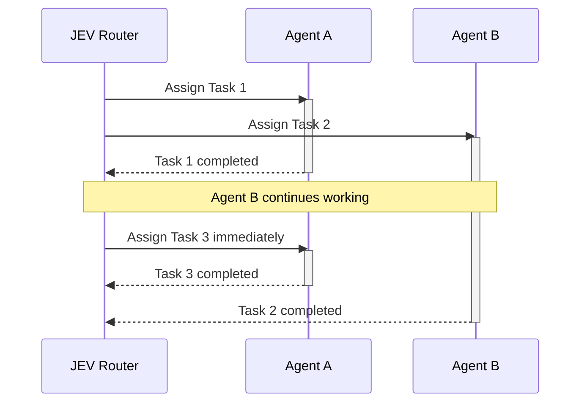

# JEV AgentNetwork

https://github.com/user-attachments/assets/cf139790-4a4c-49d3-9909-50828d144e2e

**An event-driven network of general-purpose AI agents, coordinated by JEV.**

[中文](README.zh-CN.md)

JEV AgentNetwork explores a multi-agent topology in which JEV observes live network state and assigns pending work to available agents. `AgentRouter` is the reference implementation in this repository: JEV makes the routing decisions, while general-purpose agents execute work concurrently.

The network is event-driven rather than round-based. Whenever an agent finishes, its completion event triggers a new routing decision immediately; the router does not wait for the rest of the team to reach a synchronization point. Agents are general-purpose by default, and roles are optional prompt hints rather than fixed capability boundaries.

## Network model

The pattern has three defining properties:

- **General-purpose nodes:** agents are interchangeable by default; optional roles can guide behavior without defining hard job boundaries.
- **Event-driven routing:** every completion can immediately release and reassign capacity.
- **State-aware scheduling:** the router sees pending work, recent results, and which agents are idle or busy.

In this example, Agent A finishes first and starts Task 3 while Agent B is still working on Task 2:



This repository focuses on the network topology and scheduling behavior. It is not intended to replace a general-purpose agent SDK or require every application to use multiple agents.

The reference implementation demonstrates:

- JEV-based multi-agent routing
- parallel agent orchestration
- role-free and role-optional agent teams
- dynamic idle-agent selection
- editable demo tasks, user-created workstreams, and user-defined Todo steps
- human-in-the-loop workflows
- OpenAI Responses API agents with real tools

## Quickstart

Requirements: Python 3.10+, an OpenAI-compatible API key, and a JEV API key.

### 1. Clone

```bash
git clone https://github.com/Kelly-Leeee/agentrouter.git
cd agentrouter
```

### 2. Add API keys

```bash
export OPENAI_API_KEY="your-openai-key"
export JEV_API_KEY="your-jev-key"
```

Optional model or endpoint configuration:

```bash
export OPENAI_BASE_URL="https://api.openai.com/v1"
export OPENAI_MODEL="gpt-5-mini"
export JEV_MODEL="jev-latest"
```

### 3. Start

```bash
./start.sh
```

The script installs the Python environment, starts AgentRouter, and opens:

```text
http://127.0.0.1:8765
```

For a remote or headless machine:

```bash
./start.sh --no-open --host 0.0.0.0
```

JEV AgentNetwork is an early research prototype. It ships with two editable demo tasks, supports user-created tasks, and runs with up to five agents. Keep API keys in environment variables; never commit them.

Apache-2.0 license.
