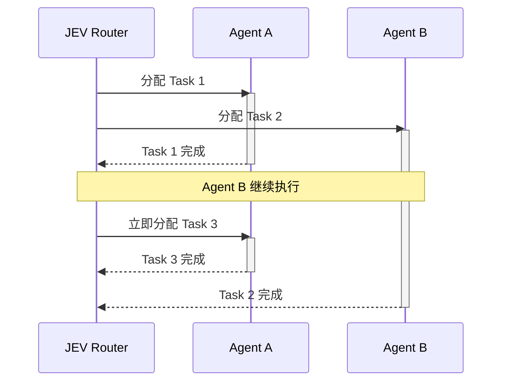

# JEV AgentNetwork

**一种由 JEV 协调、事件驱动的通用智能体网络。**

[English](README.md)

JEV AgentNetwork 探索一种 multi-agent 网络结构：JEV 持续观察实时网络状态，并把待处理工作分配给当前可用的 agent。`AgentRouter` 是这个仓库中的参考实现——JEV 负责 routing decision，多个通用智能体负责并发执行工作。

这个网络由事件驱动，而不是按同步轮次运行。任何智能体完成任务时，completion event 都会立即触发一次新的 routing decision，不需要等待整个 team 到达同步点。智能体默认是通用节点；role 只是可选的 prompt 提示，而不是固定的能力边界。

## 网络模型

这种模式有三个核心特征：

- **通用节点：** agent 默认可以相互替代；可选 role 可以引导行为，但不会划定固定的工作边界。
- **事件驱动 routing：** 每次任务完成都可以立即释放计算能力，并触发下一次分配。
- **状态感知 scheduling：** router 可以看到待处理工作、最近的执行结果，以及每个 agent 的 idle/busy 状态。

下面的例子中，Agent A 先完成 Task 1，并在 Agent B 仍执行 Task 2 时立即开始 Task 3：



这个仓库关注的是网络结构和调度行为，而不是要替代通用 agent SDK，也不主张所有应用都应该使用多个智能体。

这个参考实现演示了：

- 基于 JEV 的 multi-agent routing
- 并行 agent orchestration
- role-free 和 role-optional agent team
- 动态寻找空闲智能体
- 可编辑的 demo 任务、用户创建的 workflow 和自定义 Todo 步骤
- human-in-the-loop workflow
- 使用真实工具的 OpenAI Responses API agent

## Quickstart

需要 Python 3.10+、OpenAI-compatible API key 和 JEV API key。不需要 Node.js。

### 1. Clone

```bash
git clone https://github.com/Kelly-Leeee/agentrouter.git
cd agentrouter
```

### 2. 配置 API key

```bash
export OPENAI_API_KEY="你的-openai-key"
export JEV_API_KEY="你的-jev-key"
```

如果需要修改模型或 API endpoint：

```bash
export OPENAI_BASE_URL="https://api.openai.com/v1"
export OPENAI_MODEL="gpt-5-mini"
export JEV_MODEL="jev-latest"
```

### 3. 启动

```bash
./start.sh
```

脚本会自动安装 Python 环境、启动 AgentRouter，并打开：

```text
http://127.0.0.1:8765
```

远程或无图形界面的机器使用：

```bash
./start.sh --no-open --host 0.0.0.0
```

JEV AgentNetwork 目前是早期研究原型，内置两个可编辑的 demo 任务，也支持用户创建新任务，最多可运行五个智能体。API key 应保存在环境变量中，切勿提交到 Git。

Apache-2.0 license。
